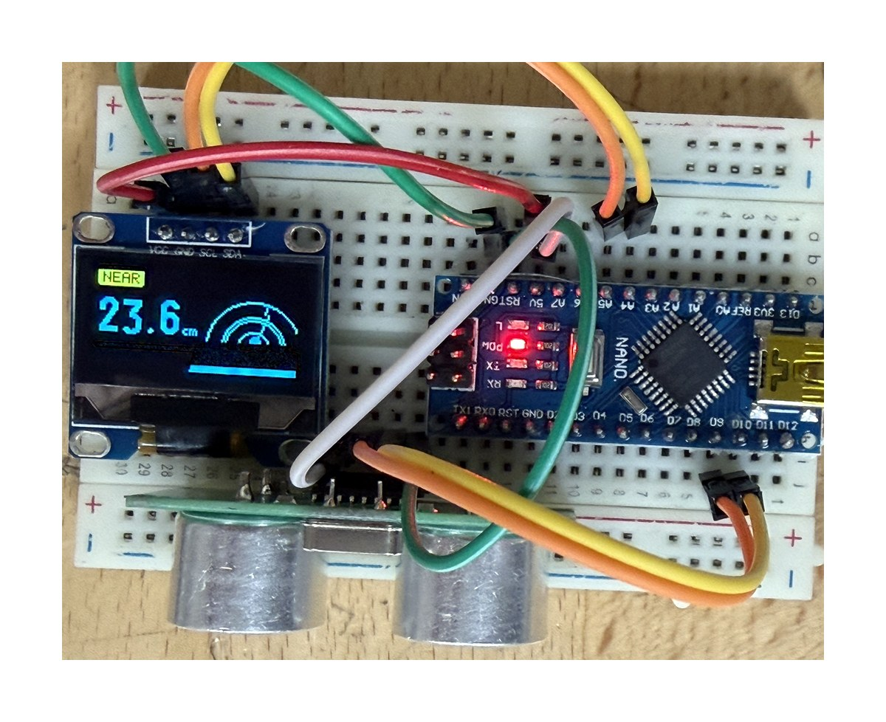
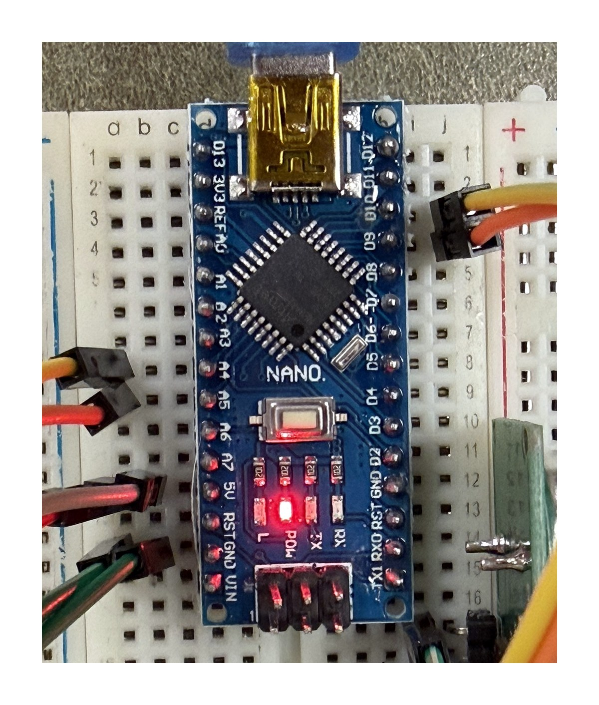
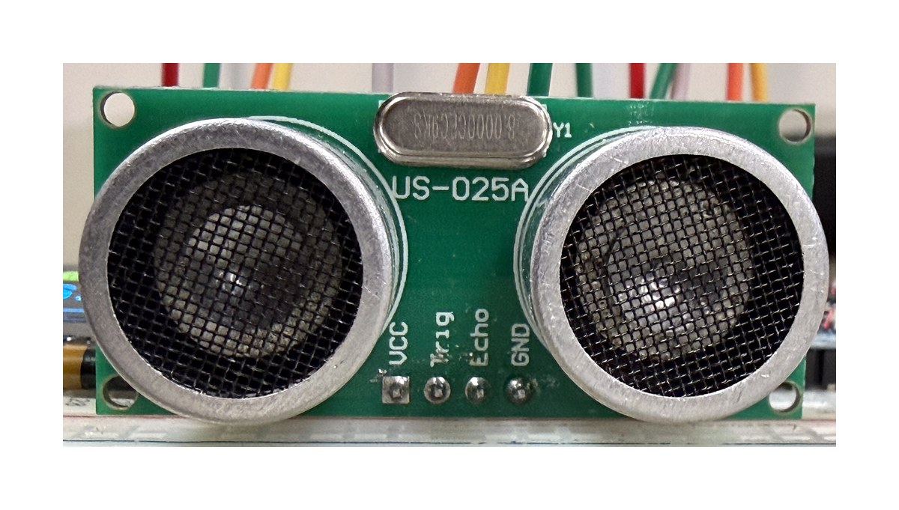
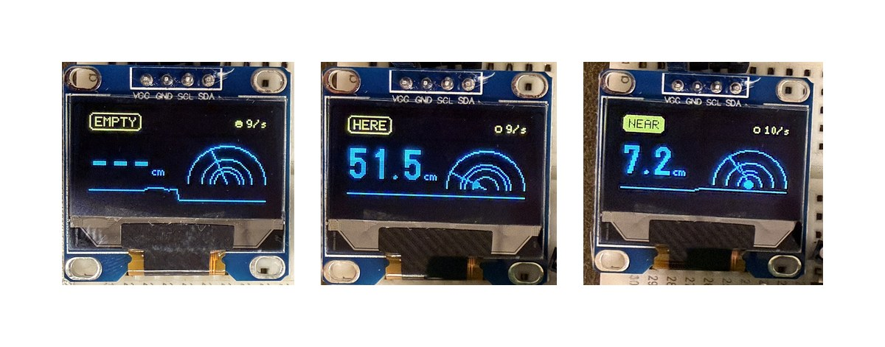

# The bench track

An Arduino Nano and two sensors in place of the camera. The bench swaps the sensor and nothing else: `piece.js` and `fake-sense.js` stay exactly as they are, and your State Table works the same way. Bench pairs open `bench.html` instead of `index.html`, and write their rows in `bench/table-bench.js` instead of `table.js`. The steps are in the main README, under **Bench pairs**.

**Simple sensor first.** Every pair builds with sensors from the shelf below, the simple tier, and gets them working in the browser before anything else. An advanced sensor is a second sensor, added after the simple one works, never instead of it.

## Building it

The kits come apart, so building the circuit is part of your work.

1. A Nano, a breadboard and jumpers from the north racks in the Innovation Commons. If the Nano's header pins aren't soldered yet, that comes first. Ask Mr. Reasy before you heat an iron.
2. Two sensors on the one Nano, one per partner. Wire each one and check it in the Arduino IDE's Serial Monitor at 115200 before the browser sees it.
3. Add your sensor's number to the line `bench.ino` prints (`Serial.print(" light "); Serial.print(analogRead(A0));`), then its function in `SIGNALS` in `sense-serial.js`, then its name in `bench/table-bench.js`.

## The reference build

This one works, end to end: a Nano and an HC-SR04 on a breadboard, with an optional 0.96 in screen, read by `bench.html` in Chrome. Build yours to match first, then change it.

| Part | Pin | Nano pin |
|---|---|---|
| HC-SR04 | VCC | 5V |
| HC-SR04 | GND | GND |
| HC-SR04 | TRIG | D9 |
| HC-SR04 | ECHO | D10 |
| OLED (optional) | VCC | 5V |
| OLED (optional) | GND | GND |
| OLED (optional) | SDA | A4 |
| OLED (optional) | SCL | A5 |

*The Nano's pins: D9 and D10 on the right go to the sensor; A4, A5, 5V and GND on the left.*

*Ours is a US-025A, a clone of the HC-SR04. Same four pins in the same order (VCC, Trig, Echo, GND), same wiring, same sketch. Either board works.*

Flash `bench/bench.ino` for the sensor alone. Open `bench.html` on localhost in Chrome, click **Connect the Arduino**, and pick the board. Press **D**: a hand at about 40 cm or closer reads `close`, further away reads `here`, and an empty room reads `nobody` after two seconds.

**The lag is the table, not the wire.** Each row's hold (0.5, 1 and 2 seconds in `bench/table-bench.js`) is how long a rule has to stay true before the state changes, and the readings are smoothed so one bad echo doesn't count. Short holds feel instant and flicker; long holds feel calm and slow. Choosing them is part of your table.

**If the upload fails** with `not in sync` or `programmer is not responding`, the Nano has the old bootloader, which is common on clone boards. In the Arduino IDE choose **Tools → Processor → ATmega328P (Old Bootloader)** and upload again (in `arduino-cli`, the board is `arduino:avr:nano:cpu=atmega328old`). After a failed upload, unplug the Nano and plug it back in before the next try, because the port can stay stuck.

### The screen (optional)

`bench/oled_demo/oled_demo.ino` is `bench.ino` plus a readout on a 0.96 in SSD1306 screen (128 x 64, I2C): a state badge, the distance in big digits, a sonar sweep with a dot at the measured range, and a scrolling trace of the history. It prints the same lines over USB, so `bench.html` works with it unchanged. It needs the **U8g2** library (Arduino IDE → Library Manager). On the two-colour screens the top strip is yellow and holds the status.

*Three states, three thresholds: EMPTY when nothing echoes back (this photo predates the fix that shows `---` instead of 400), HERE closer than 120 cm, NEAR closer than 30 cm. That's a State Table, drawn on a screen. Yours will have different words and different numbers.* The screen's badge thresholds are for the screen only; your real State Table still lives in the browser. It's an extra for after the sensor works, never instead of it.

## What's on the shelf

| Sensor | A signal it can give | Watch for |
|---|---|---|
| HC-SR04 ultrasonic | `near`, `present` | The worked example in `bench.ino`. It reports the nearest thing in a cone about 30° wide, so flat on a desk it hears the desk: aim it up or off the edge. Soft clothing swallows the echo. |
| PIR motion | `moving` | On or off, and it holds itself on for a few seconds. Someone standing still disappears. |
| Photoresistor | `shade` | Needs a 10k resistor beside it. The room's light changes through the day. |
| TCRT5000 reflective IR | `close` | A hand within a few centimetres, nothing further. |
| Sound sensor (KY-037/038) | `loud` | Read its analog pin (A0), which gives a level. The digital pin only says over or under its dial. |
| TTP223 touch pad | `touch` | Works through a few millimetres of paper or plastic. |
| Piezo disc | `knock` | It spikes for an instant on a tap, so give its state a hold. |
| Tilt switch | `tilted` | For a piece someone picks up. |

Every sensor here prints a number; the meaning is yours. A `near` of 0.9 is a distance, never a feeling.

## Advanced sensing

Mr. Reasy's own bench sensors, lent to pairs whose simple sensor already works in the browser. Ask him for one; they live on his bench, not the shelf. Several need a 3.3 V board with more memory than the Nano: the Nano 33 IoT (north racks, a few) or an ESP32-S3 from his bench.

| Sensor | A signal it can give | How it talks | Board | Difficulty |
|---|---|---|---|---|
| MPR121 capacitive touch (12 pads) | `touched`, and which pad | I2C | Nano | Moderate. Any conductive thing becomes a pad: foil, fruit, graphite. |
| RC522 RFID reader | `tagged`, and which card | SPI | Nano, 3.3 V power only | Moderate. Each card has its own ID, so a piece can know which object is on it. |
| AS7341 / AS7343 spectral sensor | `colour`, `bright` | I2C | Nano | Moderate. Eight to fourteen colour bands; it needs steady light on the object. |
| BNO080/085 IMU | `tilted`, `turning`, `still` | I2C | Nano 33 IoT or ESP32-S3 | Hard. Gives orientation directly; too big for the Nano's memory. |
| INMP441 microphone | `loud` | I2S | Nano 33 IoT or ESP32-S3 | Hard. A real digital microphone; the Nano has no I2S. |
| HLK-LD2450 radar | `near`, `present`, `count`, where people stand | UART at 256000 baud | Nano 33 IoT | Hard. Tracks up to three people by position, through thin walls and in the dark. |
| Load cell, 10 kg or 15 kg bar | `loaded`, `weight` | Needs an amplifier board (HX711 or NAU7802) | Nano | Moderate once the amplifier is in hand. Ask Mr. Reasy whether one is free before you plan on it. |

Same rule as the shelf: the sensor gives a number and your State Table gives it a meaning. A radar `count` of 2 is two bodies in range, not a crowd that wants anything.

